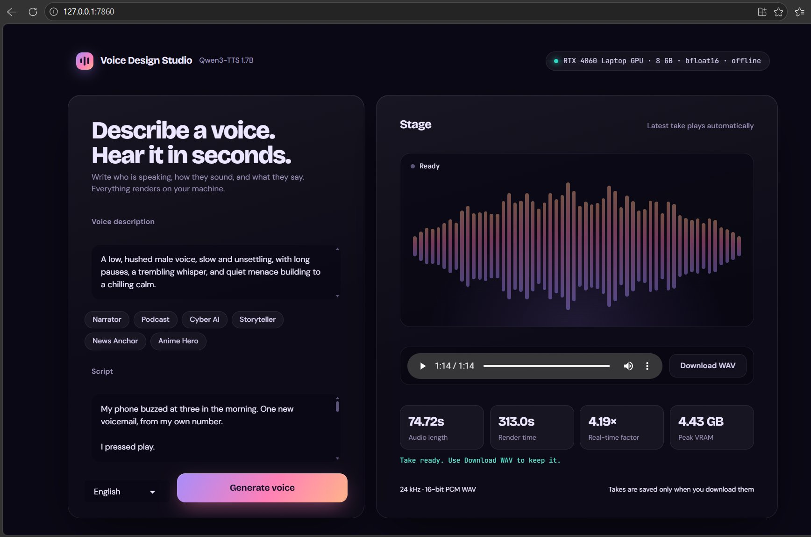

<div align="center">

# 🎙️ Voice Design Studio

### *Describe a voice. Hear it in seconds.*

**Local · Offline · RTX-Accelerated · Zero Cloud**

[](https://python.org)
[](https://pytorch.org)
[](https://gradio.app)
[](LICENSE)
[](/)
[](https://huggingface.co/Qwen/Qwen3-TTS-12Hz-1.7B-VoiceDesign)

</div>

---

> **Voice Design Studio** is a fully local, GPU-accelerated text-to-speech application built on Alibaba's `Qwen3-TTS-1.7B-VoiceDesign` model. You describe a voice in plain English — the age, timbre, pacing, emotion, accent — and the model synthesizes it on your machine. No API keys. No subscriptions. No data ever leaves your computer.

---

## ✨ What Makes This Different

Most TTS tools give you a dropdown of preset voices. This one gives you a **prompt box**.

Write *"An elderly grandfather recounting a nostalgic fairytale, raspy warm timbre, slow gentle pacing, and comforting cadence"* — and that's exactly what you get. The voice isn't selected from a list; it's **synthesized from your description**.

```
"A calm, soothing female AI assistant with a smooth,
precise cadence, subtle futuristic resonance, and clean inflection."
```
→ Rendered locally. On your GPU. In seconds.

---

## 🖥️ Preview



> *Dark obsidian/violet theme · Animated equalizer waveform · Real-time stats (audio length, render time, RTF, peak VRAM) · Audio playback + Download WAV · Single-page, no-scroll layout*

The UI is single-page, no-scroll, with a persistent dark/light mode toggle in the top-right corner of the navbar.

---

## 🚀 Features

| Category | Capability |
|---|---|
| 🎨 **Voice Design** | Natural-language voice description — age, gender, accent, emotion, pace, timbre |
| ⚡ **GPU Acceleration** | Runs in `bfloat16` on CUDA — RTX 4060 uses ~4 GB VRAM |
| 🌍 **10 Languages** | English · Chinese · Japanese · Korean · German · French · Spanish · Italian · Russian · Auto |
| 🎭 **Preset Chips** | Narrator · Podcast · Cyber AI · Storyteller · News Anchor · Anime Hero |
| 📊 **Live Stats** | Audio length · Render time · Real-time factor · Peak VRAM |
| 💾 **Auto-Save** | Every take saved as `outputs/VoiceDesign_YYYYMMDD_HHMMSS.wav` |
| 🌙 **Dark / Light Mode** | Toggle switch in navbar, persisted in `localStorage` |
| 📡 **100% Offline** | No internet required after model download — zero telemetry |
| 🔉 **24 kHz · 16-bit PCM** | Broadcast-quality WAV output |

---

## 🔧 Hardware Requirements

| Component | Minimum | Tested On |
|---|---|---|
| **GPU** | 6 GB VRAM (CUDA) | NVIDIA RTX 4060 Laptop 8 GB |
| **CPU** | Any modern x86-64 | Intel Core i7-13620H |
| **RAM** | 8 GB | 16 GB DDR5 |
| **Storage** | ~6 GB free | NVMe SSD |
| **OS** | Windows 10/11 | Windows 11 Build 26200 |
| **CUDA** | 12.x | 12.6 (Driver 610.62) |

> **CPU-only fallback**: The app will run on CPU if no CUDA GPU is detected, but generation will be significantly slower (minutes instead of seconds).

---

## 📦 Installation

> **Prerequisites**: [Python 3.12](https://www.python.org/downloads/) and an NVIDIA GPU with CUDA drivers installed.  
> Check your CUDA version first: `nvidia-smi` (top-right corner shows CUDA version)

---

### Step 1 — Create a project folder

Open **PowerShell or Command Prompt** and run:

```bash
mkdir "C:\Voice Design Studio"
cd "C:\Voice Design Studio"
```

> You can use any path you like — just stay consistent with it in the steps below.

---

### Step 2 — Set up a Python virtual environment

```bash
python -m venv venv
venv\Scripts\activate
```

Your terminal prompt should now show `(venv)` — you're inside the isolated environment.

---

### Step 3 — Upgrade pip

```bash
python -m pip install --upgrade pip
```

---

### Step 4 — Install PyTorch with CUDA support

```bash
pip install torch==2.14.1+cu126 torchaudio==2.14.0+cu126 --index-url https://download.pytorch.org/whl/cu126
```

> **Match your CUDA version** — replace `cu126` with yours if different:
> | CUDA Version | Flag to use |
> |---|---|
> | 12.6 | `cu126` |
> | 12.4 | `cu124` |
> | 12.1 | `cu121` |
> | 11.8 | `cu118` |
>
> Not sure? Run `nvidia-smi` and check the top-right — it shows your CUDA version.

Verify the install:
```bash
python -c "import torch; print('CUDA:', torch.cuda.is_available(), '|', torch.cuda.get_device_name(0))"
```
You should see `CUDA: True | NVIDIA GeForce RTX ...`

---

### Step 5 — Install project dependencies

```bash
pip install qwen-tts==0.1.1 gradio==6.17.3 transformers accelerate soundfile numpy huggingface_hub
```

---

### Step 6 — Download the model

> The model is **~4.5 GB**. This is a one-time download — it caches permanently.

Run this inside Python (still in the activated venv):

```bash
python -c "from huggingface_hub import snapshot_download; snapshot_download(repo_id='Qwen/Qwen3-TTS-12Hz-1.7B-VoiceDesign', cache_dir='D:/hf_cache')"
```

Or create a small download script `download_model.py`:

```python
from huggingface_hub import snapshot_download

snapshot_download(
    repo_id="Qwen/Qwen3-TTS-12Hz-1.7B-VoiceDesign",
    cache_dir="D:/hf_cache",   # ← change to wherever you want to store the model
)

print("✅ Model downloaded successfully.")
```

```bash
python download_model.py
```

---

### Step 7 — Set the model cache environment variable

Tell the app where the model lives by setting `HF_HOME`:

**Temporarily (current session only):**
```bash
set HF_HOME=D:\hf_cache
```

**Permanently (recommended):**

1. Open **Windows Settings** → Search for `Environment Variables`
2. Click **"Edit the system environment variables"**
3. Under **User variables**, click **New**
4. Variable name: `HF_HOME` · Variable value: `D:\hf_cache`
5. Click OK and restart your terminal

---

### Step 8 — Create the outputs folder

```bash
mkdir outputs
```

This is where every generated WAV is auto-saved.

---

## ▶️ Launch

### One-click (recommended)

Double-click **`start_voice_design.bat`** in the project folder.

### Manual

```bash
venv\Scripts\activate
python app.py
```

Then open your browser at **[http://127.0.0.1:7860](http://127.0.0.1:7860)**

---

## 🧠 How It Works

```
Your text prompt
      +
Voice description  ──→  Qwen3-TTS-1.7B  ──→  Speech tokens  ──→  24 kHz WAV
      +                   (bfloat16)          (12 Hz codec)
Language tag
```

1. **Voice Description** is embedded as a natural-language conditioning prompt directly into the TTS model
2. **Qwen3-TTS-1.7B** is a multi-codebook speech encoder/decoder from Alibaba's Qwen team, using a 12 Hz token rate
3. The model runs entirely in GPU memory (`bfloat16`, ~4 GB VRAM) — no cloud API, no network calls
4. Output is decoded to a 24 kHz, 16-bit PCM mono WAV and streamed back to the browser
5. Every take is simultaneously saved to `outputs/` for permanent access

---

## 📈 Performance Benchmarks

> Measured on RTX 4060 Laptop GPU (8 GB), Windows 11, PyTorch 2.14 + CUDA 12.6

| Metric | Value |
|---|---|
| **Peak VRAM** | ~3.94 – 3.96 GB |
| **Model Load Time** | ~8–12 seconds (first launch) |
| **Short sentence** (~10 words) | ~5–8 seconds render |
| **Medium paragraph** (~40 words) | ~20–35 seconds render |
| **Real-time factor** | 4× – 7× (audio len / render time) |
| **Output quality** | 24 kHz, 16-bit PCM mono WAV |
| **GPU headroom** | ~4 GB free on 8 GB card |

---

## 📁 Project Structure

```
voice-design-studio/
│
├── app.py                      ← Main Gradio application (all UI + inference logic)
├── start_voice_design.bat      ← One-click Windows launcher
├── test_generation.py          ← CLI smoke-test script
├── README.md                   ← This file
│
├── venv/                       ← Python 3.12 virtual environment
├── outputs/                    ← Auto-saved WAV files (VoiceDesign_YYYYMMDD_HHMMSS.wav)
└── models_cache/               ← Symlink / junction to HuggingFace model cache
```

---

## 🛠️ Troubleshooting

<details>
<summary><strong>CUDA not detected / running on CPU</strong></summary>

Run this to verify:
```python
import torch
print(torch.cuda.is_available())   # Must be True
print(torch.cuda.get_device_name(0))
```
If `False`, reinstall PyTorch with the correct CUDA version for your driver. Use [https://pytorch.org/get-started/locally/](https://pytorch.org/get-started/locally/).
</details>

<details>
<summary><strong>Model not found / FileNotFoundError</strong></summary>

Make sure `HF_HOME` points to the directory where you ran `snapshot_download`. The model folder should be at:
```
<HF_HOME>/hub/models--Qwen--Qwen3-TTS-12Hz-1.7B-VoiceDesign/
```
</details>

<details>
<summary><strong>SoX / audio warning on startup</strong></summary>

This is cosmetic. The app uses `soundfile` for all audio I/O — SoX is not required. You can safely ignore the warning. Audio output will be unaffected.
</details>

<details>
<summary><strong>Out of VRAM (OOM error)</strong></summary>

The model uses ~4 GB VRAM in `bfloat16`. If you have a 6 GB card, close other GPU-intensive applications. If you have less than 6 GB, the model will fall back to CPU automatically (much slower).
</details>

<details>
<summary><strong>Browser audio player shows but doesn't play</strong></summary>

The app streams audio as raw numpy arrays (`gr.Audio(type="numpy")`) to bypass Windows path URL-encoding issues. If you still can't hear audio, try a different browser (Chrome / Edge recommended).
</details>

<details>
<summary><strong>Port 7860 already in use</strong></summary>

Another Gradio app may be running. Either stop it, or edit `app.py` and change `server_port=7860` to any free port like `7861`.
</details>

---

## 📜 License

This project is released under the **Apache 2.0 License**.

The underlying model — `Qwen3-TTS-12Hz-1.7B-VoiceDesign` — is also Apache 2.0 licensed by the Alibaba Qwen team. See the [model card](https://huggingface.co/Qwen/Qwen3-TTS-12Hz-1.7B-VoiceDesign) for full details.

---

## 🙏 Credits

| Contributor | Role |
|---|---|
| [Alibaba Qwen Team](https://github.com/QwenLM) | Qwen3-TTS model architecture and weights |
| [HuggingFace](https://huggingface.co) | Model hosting and `transformers` / `huggingface_hub` libraries |
| [Gradio](https://gradio.app) | Web UI framework |
| [PyTorch](https://pytorch.org) | Deep learning backend |

---

<div align="center">

**Built locally. Rendered privately. Runs entirely on your machine.**

*No cloud. No quota. No compromise.*

</div>
